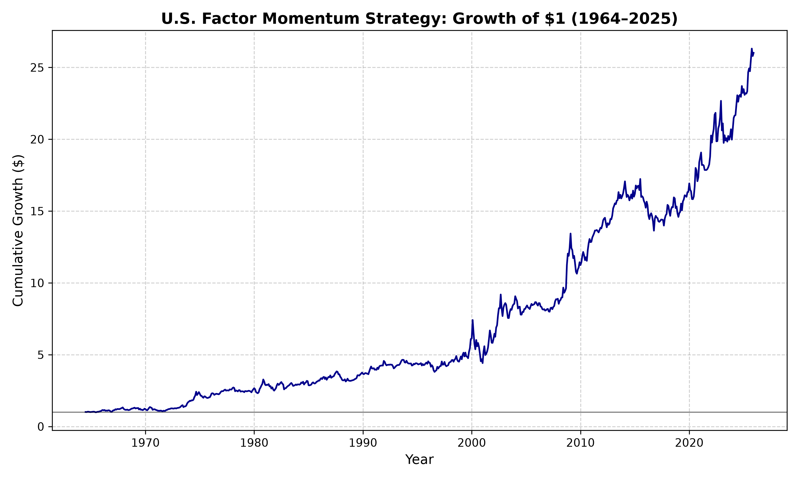

# Factor Momentum in U.S. and Chinese Equity Markets

Do factor premia exhibit momentum? I apply an identical long/short factor-timing strategy to the five Fama-French factors in both markets and compare the results.

## Research question
Does a strategy that goes long factors with positive trailing 12-month returns and short factors with negative trailing returns earn significant risk-adjusted returns, and does the effect differ between the U.S. and China?

## Data
- **U.S.**: Kenneth French Data Library, Fama/French 5 Factors (2x3), monthly, July 1963 – December 2025.
- **China**: CSMAR Fama-French five-factor data (all A-shares, free-float weighted), monthly, January 2021 – December 2025.

The first 12 months of each sample are used only to form the first momentum signal, so the U.S. strategy trades from July 1964 and the China strategy from January 2022.

## Method
12-month lookback, one-month holding period, monthly rebalancing. Equal-weighted long/short positions across five factors: Mkt-RF, SMB, HML, RMW, CMA. The long leg sums to +1 and the short leg to -1. Signals are lagged one month to avoid look-ahead bias.

## Key results

*U.S. full sample (July 1964 – December 2025):*
- **Annualized Return:** 6.09%
- **Annualized Volatility:** 12.57%
- **Sharpe Ratio:** 0.48
- **Max Drawdown:** -40.46% (February 2000 – January 2001)

*Matched window (January 2022 – December 2025, 48 months):*

| Metric | U.S. | China |
|---|---|---|
| Annualized Return | 8.81% | 2.48% |
| Annualized Volatility | 11.48% | 12.02% |
| Sharpe Ratio | 0.77 | 0.21 |
| Max Drawdown | -12.91% | -21.12% |

*Robustness:*
- 10 bps transaction costs (2022–2025): U.S. Sharpe 0.77 → 0.71; China 0.21 → 0.14.
- 6-month lookback: U.S. full-sample Sharpe 0.48 → 0.38; China 0.21 → -0.11.




## How to reproduce
```bash
pip install -r requirements.txt

# 1. Get and clean the data
python src/download_us.py
python src/build_panel.py
python src/build_china_panel.py   # requires data/raw/china_factors_raw.xlsx from CSMAR

# 2. Run the strategy and produce the results
python src/run_us_strategy.py
python src/run_china_strategy.py
python src/table.py
python src/plot_results.py
python src/robustness.py

# 3. Optional: run the tests
python -m pytest src/test_fmom.py
```

CSMAR data require a subscription, so the raw China file is not included in this repository.

## Repository structure
- `src/`: Source code for data downloads and strategy implementation
- `data/`: Data files (raw and processed are gitignored)
- `outputs/`: Generated tables and figures
- `docs/`: Methodology and provenance documentation
- `drafts/`: Paper drafts and topic statements
- `notes/`: Session notes and literature summaries

## License
MIT

## Contact
Paulo  Araujo, University of Macau, FINC7041-001