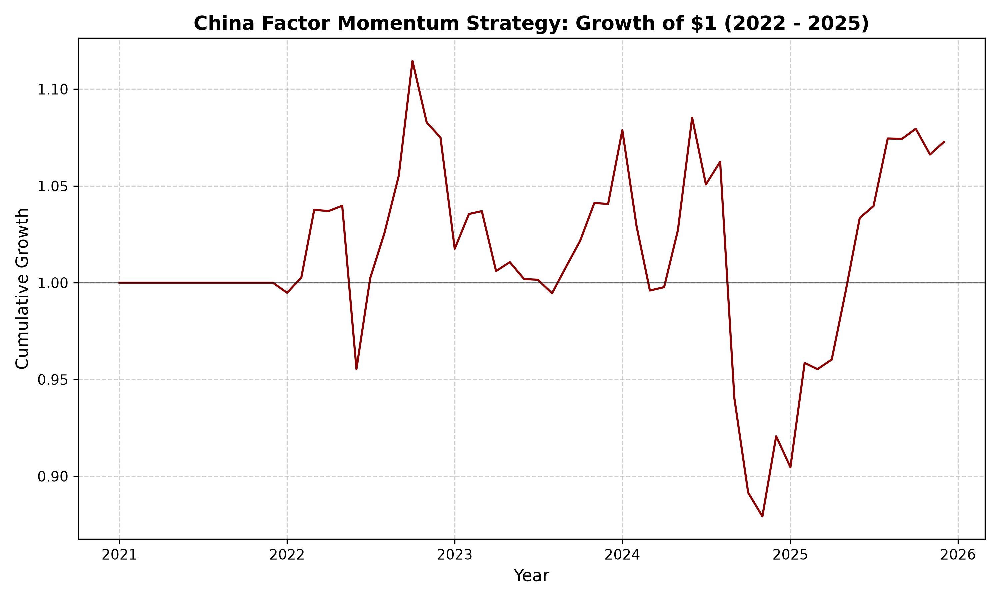

# Factor Momentum in U.S. and Chinese Equity Markets

Do factor premia exhibit momentum? I apply an identical long/short factor-timing strategy to six factors in both markets and compare the results.

## Research question
Does a strategy that goes long factors with positive trailing 12-month returns and short factors with negative trailing returns earn significant risk-adjusted returns, and does the effect differ between the U.S. and China?

## Data
- **U.S.**: Kenneth French Data Library, monthly, 1963–2025.
- **China**:  CSMAR, Monthly 2021-2025

## Method
12-month lookback, monthly rebalance, equal-weighted long/short across six factors: Mkt-RF, SMB, HML, RMW, CMA, MOM.

## Key results
*U.S. (1963–Present):*
- **Sharpe Ratio:** 0.50

*China (2021–2025):*
- **Annualized Return:** 1.98%
- **Annualized Volatility:** 10.73%
- **Sharpe Ratio:** 0.18
- **Max Drawdown:** -21.12%




## How to reproduce
```bash
pip install -r requirements.txt
python src/download_us.py
python src/download_china.py
python src/build_panel.py

## Repository structure
- `src/`: Source code for data downloads and strategy implementation
- `data/`: Data files (raw and processed are gitignored)
- `outputs/`: Generated tables and figures
- `docs/`: Methodology and provenance documentation
- `drafts/`: Paper drafts and topic statements
- `notes/`: Session notes and literature summaries

## License
MIT

## Contact
Paulo Jose Araujo, University of Macau, FINC7010-001
