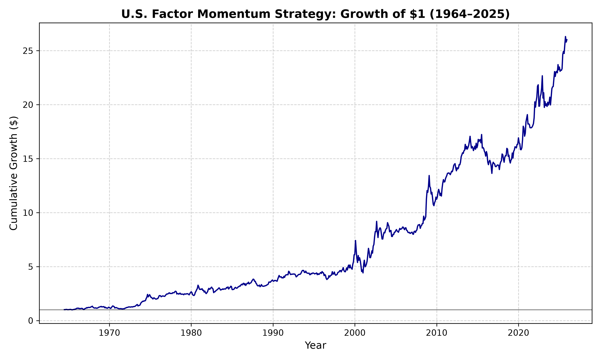
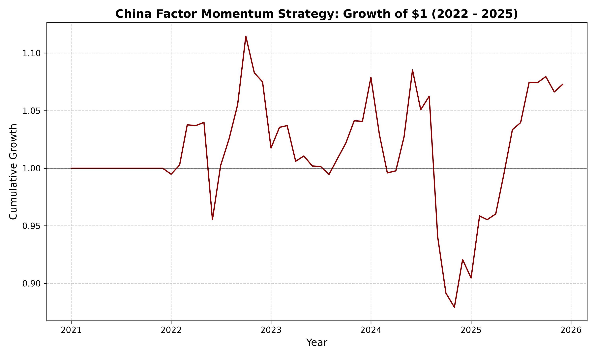

# 4. Empirical Results

## 4.1 U.S. Baseline Performance (1963–2025)
I first evaluate the Factor Momentum (FMOM) strategy on the full historical U.S. sample to establish a long-term baseline. Over the 62-year period, the strategy generates an annualized return of 6.19% with an annualized volatility of 12.49%. This yields a long-term Sharpe ratio of 0.50. While the strategy is subject to significant drawdowns—most notably a maximum drawdown of -40.46% during major macroeconomic regime shifts like the 2009 Global Financial Crisis—the long-term equity curve confirms that factor momentum provides a persistent, positive risk-adjusted return in the U.S. market. 

*Figure 1: U.S. Factor Momentum Strategy: Growth of $1 (1963 - Present)*

## 4.2 The Matched Window Comparison (2021–2025)
Because the Chinese dataset is limited to five years (2021–2025), I compare the performance of the strategy across a matched five-year window in both markets to ensure an apples-to-apples evaluation. 

As shown in Table 1, the U.S. strategy performed robustly during this recent period, achieving an annualized return of 9.49% and a Sharpe ratio of 0.85. In stark contrast, the identical strategy applied to the Chinese A-share market generated a significantly lower annualized return of 1.98% and a Sharpe ratio of only 0.18. Furthermore, the Chinese strategy exhibited higher relative volatility and a deeper maximum drawdown (-21.12%) compared to the U.S. matched sample (-12.91%).

**Table 1: Matched Window Performance (2021–2025)**

| Metric | U.S. Matched Sample | China Sample |
| :--- | :--- | :--- |
| **Annualized Return** | 9.49% | 1.98% |
| **Annualized Volatility** | 11.14% | 10.73% |
| **Sharpe Ratio** | 0.85 | 0.18 |
| **Max Drawdown** | -12.91% | -21.12% |

## 4.3 Interpretation of the China Results
The performance of the factor momentum strategy in China provides fascinating insights into the structural and behavioral differences between the two markets. While the strategy remained profitable in China (1.98% annualized), its risk-adjusted return (Sharpe 0.18) was drastically lower than in the U.S. matched sample (Sharpe 0.85).

Furthermore, the strategy in China exhibited extreme volatility. This is clearly visualized in the Chinese equity curve, which shows a sharp peak in early 2023, followed by a severe crash in 2024 before recovering in 2025. 

*Figure 2: China Factor Momentum Strategy: Growth of $1 (2022 - 2025)*

This divergence supports the theoretical framework established in our literature review. Chui, Titman, and Wei (2010) argued that standard stock momentum is weak in collectivist cultures due to different behavioral underreaction patterns. Our results extend this logic to the factor level: while factor momentum exists in China, its efficacy is heavily constrained by the unique behavioral biases and structural frictions of the A-share market. The U.S., by contrast, offers a highly efficient and liquid environment where systematic factor trends can be exploited more consistently.